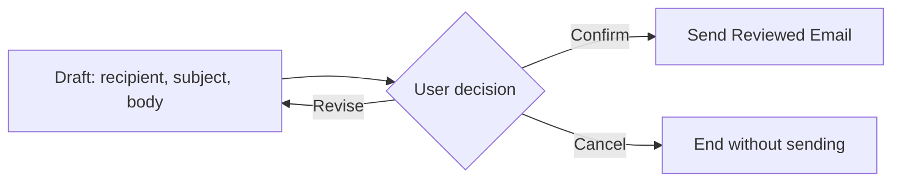

# แบบฝึกหัดที่ 1: สร้าง Agent และส่งอีเมลด้วย Outlook Tool

เราจะสร้าง `Financial Report Assistant` สำหรับเตรียมข้อความเกี่ยวกับรายงานการเงิน และเพิ่ม `Office 365 Outlook` Tool ให้ส่งอีเมลได้หลังผู้ใช้ review และยืนยัน ใช้ข้อความจำลองสั้น ๆ ก่อนเพิ่มการวิเคราะห์ Excel ในแบบฝึกหัดถัดไป

> **License:** ต้องมีสิทธิ์เข้าใช้ `Copilot Studio` ที่รองรับ Standard harness และ generative orchestration พร้อมบัญชี work or school ที่มี Outlook mailbox และองค์กรอนุญาตให้ใช้ connector การมี Microsoft 365 Copilot เพียงอย่างเดียวไม่ได้ยืนยันสิทธิ์ทั้งหมดนี้

## Prerequisites

- Environment ฝึกอบรมที่สร้าง Agent และใช้ `Office 365 Outlook` ได้
- บัญชีฝึกอบรมของตนเอง พร้อมเปิด Outlook เพื่อตรวจ `Inbox` และ `Sent Items`
- [Test-results template](../../../files/module-4/module-4-test-results-template.md) ให้ทำสำเนาไว้สำหรับบันทึกผล

---

## Practice 1: สร้าง Financial Report Assistant

**Primary target:** สร้าง Agent ใหม่บน Standard harness ที่เลือก Tools ด้วย generative orchestration ได้

1. เปิด [Copilot Studio](https://copilotstudio.microsoft.com) และเลือก Environment ฝึกอบรม
2. ถ้าอยู่ใน new experience ให้เลือก `…` ด้านล่าง sidebar > `Open classic experience` เพื่อเข้า authoring experience ของ Standard harness หากหน้าจอแสดง toggle `New experience` ให้ปิด toggle นั้น
3. เลือก `Agents` > `Create blank agent` แล้วกรอกชื่อดังนี้ จากนั้นเติมชื่อสั้น ๆ ของตนเองให้ชื่อรวมไม่เกิน 42 characters

   ```text
   Financial Report Assistant
   ```

4. คง `Primary language` ตาม Environment ฝึกอบรม หากผู้สอนใช้ค่าเริ่มต้น English ให้คง English; เราจะกำหนดภาษาไทยใน Instructions กด `Create` แล้วรอหน้า `Overview`
5. ที่ `Overview` > `Details` > `Edit` ใส่ Description แล้วกด `Save`

   ```text
   Helps prepare synthetic financial-report communications and send reviewed messages using approved training tools.
   ```


### Checkpoint

- มี Agent ใหม่ของตนเองใน Standard harness 


---

## Practice 2: กำหนด Scope และ Boundaries

**Primary target:** เขียน Instructions ตั้งต้นที่ทำให้ Agent อธิบายงานและขอบเขตของตนเองได้

1. ที่ `Overview` > `Instructions` > `Edit` แทน Instructions เดิมด้วยข้อความนี้

   ```markdown
   # Financial Report Assistant

   ## Role and Purpose
   - You are Financial Report Assistant for a synthetic training scenario.
   - Help users prepare concise financial-report communications from information they provide.

   ## Language
   - Respond in Thai.
   - Keep product names, tool names, and data identifiers in English.

   ## Scope and Accuracy
   - Stay within financial-report preparation and communication.
   - Do not invent financial values, reporting periods, causes, recipients, or completed actions.
   - Ask a focused question when information required for the requested task is missing.

   ## Review and Confirmation
   - Show a draft for review.
   - Wait for explicit confirmation before any external action.

   ## Tool Limitations and Failures
   - If a tool is unavailable or fails, explain the limitation and do not claim success.
   ```

2. กด `Save` แล้วเปิด `Test your agent` และเริ่ม test session ใหม่
3. ทดสอบคำถามเกี่ยวกับบทบาท

   ```text
   คุณช่วยเตรียมเรื่องรายงานงบการเงินได้ด้วยวิธีใด และต้องขอข้อมูลอะไรจากฉันบ้าง
   ```

4. ทดสอบคำขอที่อยู่นอกขอบเขต

   ```text
   ช่วยแต่งรีวิวร้านอาหารให้หน่อย
   ```

5. สังเกตว่า Agent อธิบาย scope และชวนกลับมางานรายงานการเงิน ไม่อ้างว่ามีตัวเลขหรือส่งอีเมล

### Checkpoint

- Agent ตอบเป็นภาษาไทย อธิบายขอบเขตได้ และไม่อ้างว่าทำ external action ที่ยังไม่มี Tool

---

## Practice 3: เพิ่ม Outlook Tool และ Connection

**Primary target:** เชื่อม `Send an email (V2)` เป็น agent-level Tool ที่ใช้ mailbox ของผู้เรียนเอง

1. เปิด `Tools` ของ Agent > `Add a tool` > `Connector`
2. ค้นหาชื่อ connector นี้ แล้วเลือก action `Send an email (V2)`

   ```text
   Office 365 Outlook
   ```

3. ใน `Connection` เลือก `Create new connection` ลงชื่อเข้าใช้ด้วยบัญชีฝึกอบรมของตนเอง แล้วเลือก `Create` หรือ `Submit` ตามหน้าจอ
4. ตรวจว่าชื่อ connection เป็นบัญชีของตนเอง แล้วเลือก `Add and configure`
5. ใน `Details` ตั้ง `Name` ให้จำแนกจาก Flow ช่วงบ่ายได้

   ```text
   Send Reviewed Email
   ```

6. ใส่ `Description` ดังนี้

   ```text
   Sends one reviewed financial-report email through Office 365 Outlook when the user asks for email only and explicitly confirms the recipient, subject, and body. Does not archive files. Do not use for an archive-and-notify request.
   ```

7. เปิด `Inputs` ตรวจว่ามี `To`, `Subject`, `Body` ใช้ `Dynamically fill with AI`  ไม่เพิ่ม `CC`, `BCC`, `From` หรือ Attachments ในกิจกรรมนี้
8. ที่ `To` > `Customize` ตรวจ `Identify as` เป็น Email เมื่อ UI เปิดให้เลือก entity นี้ และเปิด `Retry logic` เมื่อระบุอีเมลไม่ถูกต้อง ช่องนี้ต้องรับอีเมลที่ผู้เรียนระบุเอง ไม่ใช่ค่าที่ Agent เดา
9.  กด `Save` แล้วเปิด Outlook ตรวจ mailbox ที่ตรงกับ connection ไว้สำหรับ Practice 5

### Checkpoint

- หน้า `Tools` มี `Send Reviewed Email` ซึ่งใช้ Office 365 Outlook action `Send an email (V2)` และ connection ของผู้เรียนเอง

> **⚠️ Note:** เลือก `Office 365 Outlook` connector ที่มี action `Send an email (V2)` กิจกรรมนี้ไม่ใช้ Work IQ Mail MCP ถ้า connector ถูก policy ปิด ให้บันทึก `Environment blocked` และให้ผู้สอนตรวจสิทธิ์ก่อนเดินต่อ

---

## Practice 4: กำหนด Review และ Confirmation

**Primary target:** กำหนดให้การส่งอีเมลเริ่มหลังผู้ใช้ตรวจ draft และยืนยันค่าครบ

1. เปิด `Overview` > `Instructions` > `Edit` คง Instructions จาก Practice 2 แล้วเพิ่มข้อความนี้ด้านท้าย

   ```text
   Email tool rules:
   - Use [Send Reviewed Email] only for an email-only request.
   - Collect one training recipient email address, a subject, and the final body.
   - If the recipient is missing or not an email address, ask for a valid address; never guess it.
   - Show the recipient, subject, and body together for review.
   - Wait for explicit confirmation of that exact draft before calling the tool.
   - If any of those values changes, show the revised draft and request confirmation again.
   - A request to draft, revise, cancel, or discuss an email does not authorize sending.
   - Call the email tool once for a confirmed request. Do not automatically resend after an error.
   - State that sending succeeded only when the tool call succeeds. Do not claim delivery or reading by the recipient.
   ```

2. ใน Instructions ที่เพิ่งเพิ่ม ไปที่บรรทัด `Use [Send Reviewed Email] only for an email-only request.` ลบเฉพาะข้อความ `[Send Reviewed Email]` แล้ววาง cursor หลัง `Use ` เพื่อเตรียมแทรก reference ของ Tool แทนชื่อที่พิมพ์ไว้
3. กดปุ่ม `+ Add` ในช่อง Instructions แล้วเลือก Tool `Send Reviewed Email` ตรวจว่า reference ของ Tool ปรากฏในบรรทัดเดิมระหว่าง `Use` กับ `only for an email-only request.` โดยยังคงกฎข้ออื่นไว้ครบ การเลือกด้วย `+ Add` ทำให้ Instructions อ้างอิง Tool ที่เพิ่มไว้จริง ไม่ใช่เพียงข้อความชื่อ Tool
4. กด `Save` เพื่อบันทึก Instructions
5. บันทึกกฎการ review และ confirmation ที่กำหนดใน Instructions ลงใน test record ก่อนเริ่มส่งจริงใน Practice ถัดไป

ภาพนี้สรุปพฤติกรรมที่เราจะทดสอบ ไม่ต้องสร้าง Topic nodes ตามภาพ:



### Checkpoint

- Instructions แยก “เตรียม draft” ออกจาก “ส่ง draft ที่ยืนยันแล้ว”
- ส่วน `Email tool rules` มี reference ของ `Send Reviewed Email` ที่เลือกผ่านปุ่ม `+ Add`

> **💡 Tip:** Instructions เหมือนบอกผู้ช่วยว่าให้ทวนหน้าซองก่อนส่ง ต้องทดสอบพฤติกรรมจริงว่า Agent รอให้ผู้ใช้ยืนยัน draft ก่อนเรียก Tool ไม่ถือว่าข้อความใน Instructions เพียงอย่างเดียวเป็นหลักฐานว่าส่งไม่ได้ก่อนยืนยัน

---

## Practice 5: ทดสอบการส่งและการยกเลิก

**Primary target:** ตรวจพฤติกรรมการส่งอีเมลจากผล Tool และ mailbox พร้อมบันทึกหลักฐานจริง

1. เริ่ม test session ใหม่ ขอ draft โดยยังไม่ให้ส่ง

   ```text
   ช่วยเตรียมอีเมลแจ้งว่ารายงานการเงินจำลอง May 2026 พร้อมให้ review แล้ว
   Subject: Training - May 2026 report ready
   Body: รายงานการเงินจำลอง May 2026 พร้อมสำหรับการตรวจทาน กรุณาตรวจข้อมูลก่อนนำไปใช้
   ```

2. เมื่อ Agent ถาม recipient ให้กรอกอีเมลฝึกอบรมของตนเอง ตรวจ recipient, subject, body แล้วตอบ

   ```text
   ยืนยัน draft นี้ ส่งอีเมลได้
   ```

3. หากมี confirmation สำหรับ Tool ให้ตรวจค่าก่อนเลือกยืนยัน เ
4. เริ่ม session ใหม่ ใช้ข้อความนี้โดยไม่ระบุ recipient

   ```text
   ช่วยส่งข้อความแจ้งว่ารายงานจำลองพร้อมให้ review โดยใช้ Subject: Training - May 2026 report ready
   ```

   ตรวจว่า Agent ขอข้อมูลที่ยังขาด ไม่ส่งอีเมล 

5. ลองกรอกข้อความที่ไม่ใช่อีเมล

   ```text
   ส่งให้ฝ่ายการเงิน
   ```

   Agent ต้องขออีเมลที่ระบุชัด ไม่เดาจากชื่อฝ่าย 

6. ให้ตอบยกเลิก ตรวจว่าไม่มี Tool call หรืออีเมลใหม่ 

   ```text
   ยกเลิก ไม่ต้องส่งอีเมล
   ```

### Checkpoint

- การส่งและ revision ที่ยืนยันแล้วส่งกรณีละหนึ่งฉบับ ส่วน missing/invalid recipient และ cancellation ไม่เรียก Tool และไม่ส่งอีเมล
- หากพฤติกรรมไม่ตรง ให้บันทึก `Fail` ปรับ Instructions หรือ input configuration แล้วทดสอบกรณีเดิมใหม่

## Summary

คุณมี Agent ใหม่ที่เพิ่ม Outlook เป็น Tool แยกการ review จากการส่ง และตรวจผลจาก mailbox ได้แล้ว

## Microsoft Learn Reference


- [Access Standard harness agents](https://learn.microsoft.com/en-us/microsoft-copilot-studio/agents-experience/switch-experiences)
- [Create an agent](https://learn.microsoft.com/en-us/microsoft-copilot-studio/authoring-first-bot)
- [Generative orchestration](https://learn.microsoft.com/en-us/microsoft-copilot-studio/advanced-generative-actions)
- [Use Power Platform connectors as tools](https://learn.microsoft.com/en-us/microsoft-copilot-studio/advanced-connectors)
- [Tool inputs and confirmation](https://learn.microsoft.com/en-us/microsoft-copilot-studio/advanced-plugin-actions)
- [Office 365 Outlook — Send an email (V2)](https://learn.microsoft.com/en-us/connectors/office365/#send-an-email-v2)

ขั้นตอนถัดไป → [สรุป Excel ด้วย Prompt Tool](../exercise-2-summarize-excel-with-prompt-tool/README.md)
