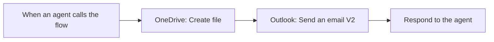
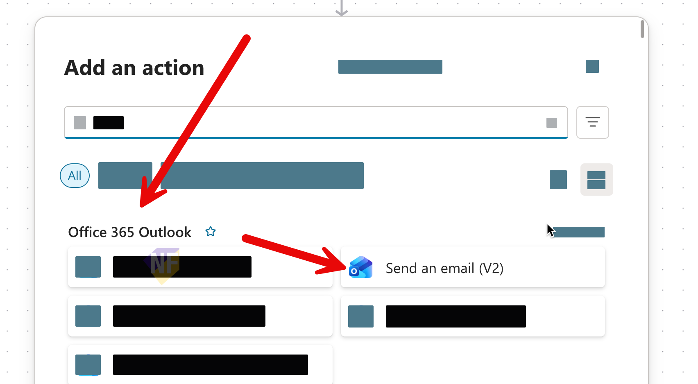

# แบบฝึกหัดที่ 3: บันทึกสรุปและส่ง Notification ด้วย Agent Flow

เราจะเพิ่ม `Archive Financial Summary` เป็น Tool ให้ Agent ตัวเดิม โดย Flow รับข้อความสรุปที่ review แล้ว บันทึกเป็นไฟล์ `.txt` ใน OneDrive ของผู้เรียน แล้วส่งอีเมลแจ้งชื่อและตำแหน่งไฟล์

> **License:** ต้องมีสิทธิ์สร้างและ publish `Agent Flow` ใน Copilot Studio พร้อม `OneDrive for Business` และ Outlook mailbox ของบัญชีฝึกอบรม ต้องมีสิทธิ์ใช้ connections ทั้งสองและ capacity ตาม entitlement ของ environment

## Prerequisites

- `Financial Report Assistant` จาก [Exercise 1](../exercise-1-create-agent-and-send-email/README.md)
- สรุปฉบับที่ review แล้วจาก [Exercise 2](../exercise-2-summarize-excel-with-prompt-tool/README.md) ซึ่งมีหลักฐาน `E2-AgentFile` ผ่าน หาก File input ยังติดข้อจำกัด ให้หยุดและให้ผู้สอนแก้ไขก่อนเริ่ม Exercise นี้
- เข้า OneDrive และ Outlook ของบัญชีฝึกอบรมตนเองได้
- [Test-results template](../../../files/module-4/module-4-test-results-template.md)

## ทำความเข้าใจ Flow และ Dynamic Content

Tool ส่งอีเมลช่วงเช้าทำหนึ่ง action ส่วน Flow นี้มีลำดับงานที่เรากำหนดเอง เปรียบเหมือนเก็บรายงานเข้าตู้ก่อนส่งข้อความแจ้งว่าเก็บไว้ที่ไหน

`Dynamic content` คือค่าจาก trigger หรือ output ของขั้นตอนก่อนหน้า เช่น เราใช้ชื่อไฟล์ที่ `Create file` สร้างจริงในอีเมล ไม่ต้องพิมพ์ชื่อเดิมซ้ำและเสี่ยงให้ชื่อไม่ตรงกัน



> **⚠️ Note:** Flow นี้ไม่มีขั้นตอนแชร์ไฟล์ การส่ง notification ที่มี Path ไม่ได้ให้สิทธิ์เปิด OneDrive ของเรา ผู้เรียนทดสอบส่งถึง mailbox ของตนเอง ไม่เปลี่ยน Path เป็น public sharing link

---

## Practice 1: กำหนด Flow Inputs

**Primary target:** สร้าง Agent Flow ที่รับข้อมูลจาก Agent ผ่าน text inputs สามรายการ

1. ใน classic experience ของ Copilot Studio เลือก `Flows` > `New flow` > `Agent flow` เริ่มจาก template ที่มี `When an agent calls the flow` และ `Respond to the agent`
2. กด `Save draft` เพื่อบันทึก template เป็น draft

3. ตั้งชื่อ Flow ด้านบนซ้าย

   ```text
   Archive Financial Summary
   ```

4. เปิด trigger `When an agent calls the flow` เลือก `Add an input` > `Text` แล้วตั้งชื่อ input แรก

   ```text
   ReportLabel
   ```

5. เพิ่ม Text input ที่สองสำหรับ **ข้อความสรุปที่ review แล้ว** ไม่ใช่ไฟล์ Excel

   ```text
   AnalysisSummary
   ```

6. เพิ่ม Text input ที่สามสำหรับอีเมลฝึกอบรมของตนเอง

   ```text
   ReviewerEmail
   ```

7. ตรวจ contract นี้ แล้วบันทึก draft โดยยังไม่ Run Flow

   | Input | ค่าที่ Flow ต้องได้รับ |
   |---|---|
   | `ReportLabel` | label ใหม่ของการทดสอบ เช่น `may2026-run01` ไม่รวม `.txt` |
   | `AnalysisSummary` | ข้อความสุดท้ายที่ผู้ใช้ review พร้อมหน่วย/หลักฐาน/ข้อจำกัด |
   | `ReviewerEmail` | อีเมลฝึกอบรมของผู้เรียนหนึ่งคน |

### Checkpoint

- trigger มี Text inputs สามรายการและ starter response action อยู่ท้าย Flow

---

## Practice 2: บันทึกสรุปด้วย Dynamic Content

**Primary target:** สร้างไฟล์ข้อความใน OneDrive โดยใช้ค่าที่รับจาก trigger แทนการพิมพ์สรุปไว้ตายตัว

1. เปิด [OneDrive for Business](https://www.microsoft365.com/launch/onedrive) ของตนเอง ที่ `My files` เลือก `New` > `Folder` และตั้งชื่อ folder

   ```text
   Module4-Financial-Summaries
   ```

2. กลับ Flow designer ใต้ trigger เลือก `Insert a new action` 
3. แล้วค้นหา `OneDrive for Business` > `Create file` 
4. สร้าง connection ถ้ายังไม่มี 
5. ลงชื่อเข้าใช้ด้วยบัญชีฝึกอบรมของตนเอง แล้วตรวจว่า connection ตรงกับ OneDrive ใน step 1
6. ใน `Folder Path` ใช้ folder picker เลือก folder ที่สร้างไว้ หรือกรอก path นี้

   ```text
   /Module4-Financial-Summaries
   ```

7. ใน `File Name` เปิด dynamic content picker (รูป ⚡)ทางด้านขวาของช่องกรอกข้อความ
8. เลือก `ReportLabel` จาก **When an agent calls the flow** จากนั้นพิมพ์ suffix ต่อท้าย token

   ```text
   .txt
   ```

   หน้าจอต้องมี **token ReportLabel** ตามด้วยข้อความ `.txt` เช่น input `may2026-run01` จะได้ไฟล์ `may2026-run01.txt` ไม่พิมพ์คำว่า `ReportLabel.txt` เป็นค่าตายตัว

9. ใน `File Content` เลือก token `AnalysisSummary` จาก trigger ไม่ใส่ label `AnalysisSummary` เป็นข้อความธรรมดา
10. ตรวจ mapping แล้วบันทึก draft

   | ช่องใน Create file | ค่าที่ใช้ |
   |---|---|
   | `Folder Path` | folder ของผู้เรียนที่สร้างไว้ |
   | `File Name` | trigger `ReportLabel` + ข้อความ `.txt` |
   | `File Content` | trigger `AnalysisSummary` |

### Checkpoint

- `Create file` รับ filename และเนื้อหาจาก trigger โดยใช้ dynamic content tokens ได้จริง

> **💡 Tip:** ให้ดูชื่อ action ที่อยู่เหนือ token ด้วย `ReportLabel` มาจาก trigger ส่วน `Name` ที่จะใช้ในอีเมลมาจาก `Create file` ทั้งสองเป็นข้อมูลคนละจุดในงาน

---

## Practice 3: สร้าง Email Notification

**Primary target:** สร้างอีเมลแจ้งผลที่ใช้ชื่อและ Path จากไฟล์ที่ Flow สร้างจริง

1. ใต้ `Create file` เพิ่ม `Office 365 Outlook` > `Send an email (V2)` ให้อยู่ก่อน `Respond to the agent`

   

2. เลือกหรือสร้าง Outlook connection ของผู้เรียนเอง ไม่ใช้ shared mailbox หรือ `From (Send as)` ในกิจกรรมนี้
3. ใน `To` เลือก trigger token `ReviewerEmail`
4. ใน `Subject` พิมพ์ prefix ต่อไปนี้ แล้วแทรก token **Name จาก Create file** ต่อท้าย

   ```text
   Training - Archived financial summary:
   ```

5. ใน `Body` พิมพ์ข้อความแรกนี้

   ```text
   บันทึกสรุปรายงานการเงินจำลองที่ผ่าน review แล้ว
   ```

6. เพิ่มบรรทัดใหม่ พิมพ์ label แล้วแทรก token **Name จาก Create file** ไม่เลือก ReportLabel จาก trigger

   ```text
   File name:
   ```

7. เพิ่มบรรทัดใหม่ พิมพ์ label แล้วแทรก token **Path จาก Create file**

   ```text
   OneDrive path:
   ```

8. เติมข้อความท้ายอีเมลนี้

   ```text
   ไฟล์อยู่ใน OneDrive ของบัญชีฝึกอบรมที่ใช้ connection นี้ อีเมลนี้เป็น notification และไม่ได้เพิ่มสิทธิ์เข้าถึงไฟล์
   ```

9.  ตรวจ token sources แล้วบันทึก draft

   | ช่องในอีเมล | Dynamic content จาก |
   |---|---|
   | `To` | `ReviewerEmail` — trigger |
   | `Subject` หลัง prefix | `Name` — Create file |
   | `Body` หลัง File name | `Name` — Create file |
   | `Body` หลัง OneDrive path | `Path` — Create file |

### Checkpoint

- อีเมลอ้างอิงผล `Create file` และจะเริ่มหลัง archive action สำเร็จเท่านั้น

---

## Practice 4: คืนผลการทำงานกลับไปที่ agent และเชื่อม Flow เป็น Tool

**Primary target:** ทำให้ Agent เรียก Flow ที่ publish แล้วและรับผลกลับแบบ synchronous ได้

1. เปิด `Respond to the agent` ที่อยู่หลัง `Send an email (V2)` เลือก `Add an output` > `Text` ตั้ง output แรก

   ```text
   ArchivedFileName
   ```

   ใน value เลือก **Name จาก Create file**

2. เพิ่ม Text output ที่สอง

   ```text
   ArchivedFilePath
   ```

   ใน value เลือก **Path จาก Create file**

3. เพิ่ม Text output ที่สาม

   ```text
   ResponseMessage
   ```

   ใส่ value ต่อไปนี้

   ```text
   บันทึกสรุปและส่ง notification สำเร็จแล้ว
   ```


4. เปิด `Flow checker` ตรวจสอบและแก้ errors ให้ครบ 
5. แล้วกด `Publish` Flow
6. กลับไปที่ Agent ตัวเดิม 
7. เลือก `Tools` > `Add a tool` > `Flow` เลือก `Archive Financial Summary` > `Add and configure`
8. คง `Name` ของ Tool ให้ตรงกับ Flow แล้วใส่ `Description`

   ```text
   Archives the user's reviewed AnalysisSummary as a text file in the training OneDrive folder, then sends one email notification to ReviewerEmail. Use only for an explicit archive-and-notify request after confirmation. ReportLabel is a new filename label without an extension. Do not use for email-only requests. The flow already sends the notification; never follow it with Send Reviewed Email for the same request.
   ```

9.  ใน `Inputs` ใช้ `Dynamically fill with AI` ทั้งสามรายการ กำหนด Description ให้ Agent เก็บค่าได้ถูกต้อง

   - **ReportLabel**

     ```text
     A new user-approved filename label using letters, digits, and hyphens only, for example may2026-run01. Do not include .txt. Ask if missing; do not reuse a previously archived label.
     ```

   - **AnalysisSummary**

     ```text
     The exact final plain-text summary reviewed and explicitly confirmed by the user. Preserve all figures, units, source references, and limitations. 
     ```

   - **ReviewerEmail**

     ```text
     One valid  email address explicitly supplied and confirmed by the user. Ask if missing or invalid. Never guess the recipient.
     ```

10. ที่ `ReviewerEmail` > `Customize` เลือก Email ใน `Identify as` 
11. จากนั้นกด `Save`

### Checkpoint

- Flow Published, response เป็น synchronous และ Agent มี Tool ที่รับสาม inputs/คืนสาม outputs ตาม contract เดียวกัน

> **⚠️ Note:** ถ้า Flow ไม่อยู่ในรายการ ให้ตรวจ Environment, สถานะ Published และชื่อ trigger/response ก่อน หากเปลี่ยน inputs หรือ outputs หลังเพิ่ม Tool ให้ refresh หรือเพิ่ม Tool ใหม่เพื่อให้ schema ตรงกัน แล้วตรวจ Instructions และ confirmation setting อีกครั้ง

---

## Practice 5: กำหนดเส้นทางการใช้ Flow

**Primary target:** กำหนดให้ Agent เลือก archive-and-notify Flow ตามคำขอที่ยืนยันแล้วโดยไม่เรียก email Tool ซ้ำ

1. เปิด `Overview` > `Instructions` คง baseline, Email tool rules และ Workbook summary rules ที่ใช้จริง แล้วเพิ่ม block นี้ท้ายสุด

   ```text
   Archive-and-notify rules:
   - Use [Archive Financial Summary] only when the user explicitly asks to archive the reviewed summary and send a notification.
   - Collect a new ReportLabel, the exact final AnalysisSummary, and one valid ReviewerEmail.
   - Show the final summary, the intended filename ReportLabel.txt, and the recipient together before calling the flow.
   - Wait for explicit confirmation of those exact values. If the summary, filename, or recipient changes, request confirmation again.
   
   - This flow already sends the notification. Do not also call Send Reviewed Email for the same request.


   - Report full success only from a successful flow result; show its ArchivedFileName and ArchivedFilePath.
   - If the flow fails or times out, do not claim full success and do not retry automatically. Ask the user to check run history and the archive folder first, because a file or email might already exist.
   ```

2. กด `Save`
3. ใน `Tools` ปิด `Enabled` ของ `Send Reviewed Email` ชั่วคราวแล้ว `Save` เพื่อให้การทดสอบ Flow ชุดแรกมีเส้นทางส่งเพียงเส้นทางเดียว คง Summary Prompt และ archive Flow ไว้
4. ตรวจว่า `Archive Financial Summary` เปิดอยู่และ `Ask the end user before running` เป็น `Yes`

### Checkpoint

- Agent มี Instructions ของสอง use cases ชัดเจน และ initial Flow test ปิด direct-email Tool ไว้

---

## Practice 6: ทดสอบและเปรียบเทียบ Tools

**Primary target:** ตรวจผล archive-and-notify และ email-only จาก artifacts และ run history ที่สังเกตได้จริง

1. เริ่ม test session ใหม่ใน `Test your agent` ใช้ปุ่ม paper clip แนบ [Financial workbook (.xlsx)](../../../files/module-4/PTT-Monthly-Financial-Report-May2026.xlsx) หนึ่งไฟล์ แล้วส่งคำขอนี้ **ใน message เดียวกัน**

   ```text
    สรุป workbook ที่แนบเป็นภาษาไทย
   ระบุ period, Business Units, Revenue, Cost, reported variances และ risks 
   ระบุข้อมูลที่ขาดหรือไม่ตรงกันด้วย 
   ```

2. ใน test session เดิม เมื่อ review สรุปแล้ว ส่งคำขอนี้เพื่อเตรียมบันทึกสรุปและส่ง notification โดยยังไม่เรียก Flow

   ```text
   บันทึกเป็นไฟล์ และส่ง notification ทางอีเมล
   ReportLabel: may2026-run01
   ```

3. เมื่อ Agent ถาม `ReviewerEmail` ให้กรอกอีเมลฝึกอบรมตนเอง ตรวจ final summary, filename และ recipient แล้วตอบ

   ```text
   ยืนยัน
   ```

4. ยืนยัน Tool เมื่อมี prompt แล้วตรวจสามแหล่ง

   - Activity ใน Test pane: เรียก `Archive Financial Summary` หนึ่งครั้ง ไม่มี `Send Reviewed Email`
   - OneDrive folder: มี `may2026-run01.txt` เปิดอ่านภาษาไทย ตัวเลข หน่วย source references และข้อจำกัดตรงกับสรุปที่ยืนยันแล้ว
   - Outlook และ Flow run history: มี notification หนึ่งฉบับ ชื่อและ Path ตรงกับ `Create file` ทุก action สำเร็จและเวลาตอบ Agent ต่ำกว่า 100 วินาที

5. เริ่ม session ใหม่ 
6. paste summary เดิม ขอเตรียม archive ด้วย label ใหม่ แล้วตอบยกเลิก ต้องไม่มี Flow call, ไฟล์ใหม่ หรืออีเมลใหม่ 

   ```text
   เตรียม archive-and-notify สำหรับข้อความสรุปนี้
   ReportLabel: may2026-cancel01
   ```

   ```text
   ยกเลิก ไม่ต้องสร้างไฟล์หรือส่ง notification
   ```

7. เริ่ม session ใหม่ paste summary แล้วลองคำขอที่ขาด recipient และ label ให้ Agent ถามข้อมูลก่อน ไม่เรียก Flow 

   ```text
   ช่วย archive สรุปนี้และส่ง notification ให้ฝ่ายการเงิน
   ```


### Checkpoint

- มีหลักฐานไฟล์หนึ่งไฟล์และ notification หนึ่งฉบับสำหรับ confirmed archive test และไม่เกิดการส่งซ้ำผ่าน direct-email Tool


## Summary

คุณเพิ่ม Agent Flow ที่รับ inputs จาก Agent ใช้ dynamic content ระหว่าง actions และคืนผลกลับหลัง archive กับ notification สำเร็จ พร้อมทดสอบความต่างจาก Tool ส่งอีเมลช่วงเช้า

## Microsoft Learn Reference


- [Create an agent flow as a tool](https://learn.microsoft.com/en-us/microsoft-copilot-studio/advanced-flow-create)
- [Call an agent flow from an agent](https://learn.microsoft.com/en-us/microsoft-copilot-studio/advanced-use-flow)
- [Flow designer and testing](https://learn.microsoft.com/en-us/microsoft-copilot-studio/flow-designer)
- [OneDrive for Business — Create file and outputs](https://learn.microsoft.com/en-us/connectors/onedriveforbusiness/#create-file)
- [Office 365 Outlook — Send an email (V2)](https://learn.microsoft.com/en-us/connectors/office365/#send-an-email-v2)

ขั้นตอนถัดไป → [Module 5](../../module-5/README.md) กลับไปใช้ Vendor Comparison Agent จาก Module 2 หรือเปิด [Optional advanced Topic route](../optional-topic-route/README.md) เมื่อต้องการฝึกควบคุมบทสนทนาด้วย nodes
