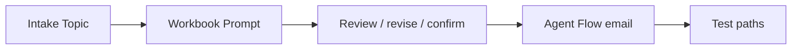

# Optional Advanced Topic Route: Financial Report Assistant

เส้นทางนี้เก็บแบบฝึกหัด Module 4 เดิมไว้สำหรับผู้ที่ต้องการฝึก `Topics`, `Question`, variables, `Condition` และ review loop เพิ่มเติม เส้นทางหลักของ Module 4 อยู่ที่ [สามแบบฝึกหัดใหม่](../README.md#main-sequence)

> **License:** ต้องมีสิทธิ์แก้ไข Topics, ใช้ Prompt file input/Code interpreter ใน route ที่ทดสอบแล้ว, สร้าง/publish Agent Flow และใช้ Office 365 Outlook connection การเข้าใช้ Copilot Studio ได้อย่างเดียวไม่ได้ยืนยัน capability ทั้งหมด

## Starting State

- เริ่มสร้าง **Agent ใหม่อีกตัว** จาก Exercise 1 ของเส้นทางนี้ ไม่ใช้ Agent ที่เพิ่ม direct-email Tool กับ archive-and-notify Flow จากเส้นทางหลัก
- ใช้ Standard harness สำหรับการฝึก Topic และใช้ workbook จำลองชุดเดียวกัน
- ต้องตรวจ Topic variables และ input/output mappings ตามแต่ละ Exercise ก่อนเรียก action; test record ของเส้นทางหลักไม่ถือเป็นหลักฐานว่าผ่านเส้นทางนี้
- เวลาของเส้นทางนี้เป็นกิจกรรมเสริมนอกช่วง 09:00–15:15 ที่กำหนดไว้ ไม่เพิ่มเป็น prerequisite ของ Module 5

## Exercise Sequence

1. [สร้าง Financial Agent และ Intake Topic](../exercise-1-create-financial-agent-and-intake/README.md)
2. [วิเคราะห์ Financial Workbook ด้วย Prompt ใน Topic](../exercise-2-analyze-financial-workbook/README.md)
3. [Review, Revise, and Confirm ด้วย Topic branches](../exercise-3-review-revise-confirm/README.md)
4. [สร้าง Agent Flow email สำหรับเส้นทาง Topic](../exercise-4-required-agent-flow-email/README.md)
5. [ทดสอบ Email Paths ของเส้นทาง Topic](../exercise-5-test-email-paths/README.md)

> **⚠️ Note:** คำว่า required ในหน้า Exercise เดิมหมายถึงลำดับภายในเส้นทาง Topic นี้ ไม่ใช่ข้อบังคับของเส้นทางหลักใหม่ การส่งอีเมลใช้ Flow หนึ่งเส้นทางใน Agent แยกนี้ อย่าเพิ่ม direct-email Tool หรือ Work IQ MCP พร้อมกันระหว่างทดสอบ

## Support Files

- [Financial workbook](../../../files/module-4/PTT-Monthly-Financial-Report-May2026.xlsx)
- [Optional Knowledge files และ prepared synthetic fallback](../../../files/module-4/README.md)

## Summary

เส้นทาง Topic ให้ฝึกการกำหนดบทสนทนาด้วย nodes และ variables ส่วนเส้นทางหลักใหม่ให้ฝึกเพิ่ม Tools ที่ Agent เลือกใช้จากคำขอโดยตรง ทั้งสองเส้นทางต้องทดสอบใน environment ของตนเอง

ขั้นตอนถัดไป → [กลับ Module 4 main route](../README.md) หรือ [Module 5](../../module-5/README.md)
